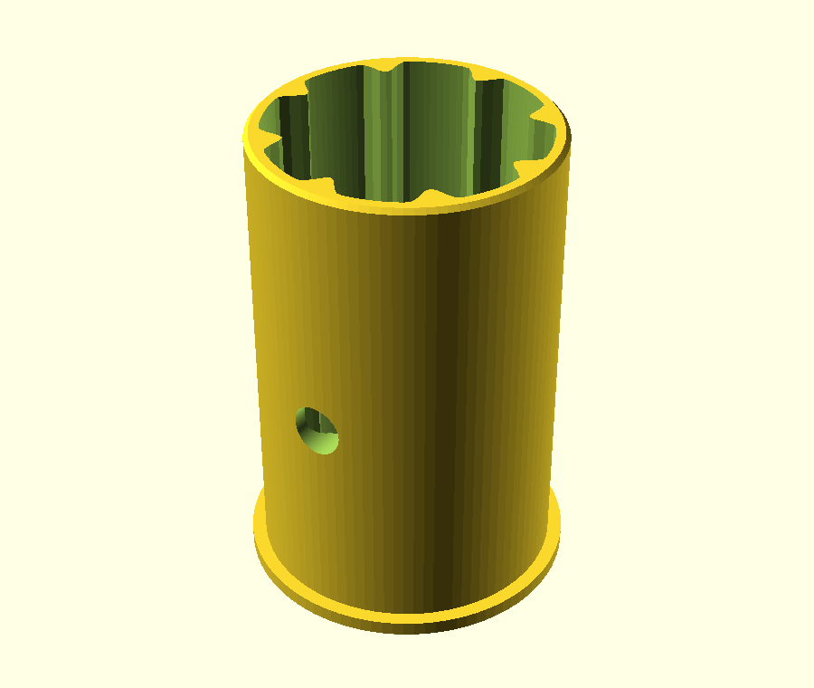

# Experimental ribbed sleeve for irregular poles

This fork explores a removable TPU sleeve inside a rigid RAD socket. It keeps
RAD's existing screw holes and fastening method. There is no new clamp, threaded
collar, or pressure shoe, and the upstream connector SCAD is unchanged.

**Status: digital prototype. No physical print, insertion-force, fastener,
creep, or shelf-load validation has been completed. No load rating is assigned.**

[Independent quality review](QUALITY_REVIEW.md) and
[machine-readable geometry results](validation-results.json) document the tested
revision. Reproduce the checks using [the test guide](../tests/README.md).

[Mouth-side view](images/sleeve-mouth.png), [diagnostic toolpaths](images/toolpaths.png)
and [slicing results](slice-results.json) show the entry taper and screw-opening
regions. No machine G-code is distributed: slice with your own calibrated profile.

## Design intent

A continuous outer sleeve wall supports broad, rounded longitudinal ribs. The
grooves between ribs provide space for the TPU to deform locally as an irregular
pole enters. Different nominal sleeve sizes handle diameter differences; local
rib deformation handles the remaining variation. This is not intended to make
one sleeve fit arbitrary bamboo shapes.

The ribs are intended to compress slightly rather than fold over like thin fins.
They do not establish a rigid joint merely because insertion feels snug. The
existing fastener provides retention, but it does not remove bending or sustained
compression from the sleeve. TPU hardness alone does not specify creep behavior.

Start with unfilled 95A TPU for the sleeve and PETG for the body. These are test
candidates, not certified material selections. A dense ribbed sleeve is the
baseline before considering open honeycombs or more elaborate pockets.

## Matched starting configuration

Open `../Rod Assisted Design Customizer.scad` and select the adjacent JSON preset
`Experimental bamboo - 26 mm sleeve socket` in OpenSCAD's Customizer. It uses:

| RAD parameter | Value | Reason |
| --- | --- | --- |
| `dowelDia` | 26 mm | Sleeve socket diameter, not bamboo diameter |
| `thickness` | 6 mm | Preserve the body wall while enlarging the bore |
| `lengthLeg` | 50 mm | Provides 44 mm usable side-socket depth with these stoppers |
| `teardropEnable` | 0 | Circular outer sleeve requires circular support |
| `stopperEnable` | 1 | Original side-leg stops remain |
| `screwOffset` | 18 mm | Screw center measured inward from the socket mouth |
| `screwAngleList` | `[0, 180]` | Original radial fastening directions |
| `screwDia` | 4 mm | Existing hole size |

Use the default sleeve with this body: 40 mm insertion depth, nominal 20 mm pole,
26 mm socket, and 0.2 mm diametral socket clearance. Measure pole diameters at
several rotations and positions over the intended engagement length first.
Diameter variation is not the same as radial travel: 2 mm diameter change is
1 mm per side for a centered circle, but eccentric or irregular poles differ.

Disabling the teardrop changes horizontal-bore printability. Inspect the actual
body orientation and slicer output; do not inherit the upstream support-free
claim for this configuration. A sleeve does not repair poorly printed bores.

## Compatibility boundaries

- Initially scoped to connector side sockets with the explicit matched preset.
  Center sockets, cross connectors, end caps, and panel mounts need their own
  insertion-depth and hole-position checks before use.
- RAD's local side socket mouth is at
  `max(lengthLeg, dowelDia + 2*thickness) + (dowelDia + 2*thickness)/2`.
  With side stoppers, its usable depth is
  `max(lengthLeg, dowelDia + 2*thickness) - thickness` (44 mm here).
  The sleeve leaves 4 mm before the original stop; its lip sits outside the mouth.
- RAD angle 0 points along local -Y, angle 90 along +X. Sleeve holes must be
  rotated into alignment before fastening. No automatic indexing key is added.
- A round sleeve in a teardrop bore has unsupported clearance near the arch.
  That combination is outside this first supported preset.
- Adjacent legs, screw access, lip interference, and stopper geometry at unusual
  angles remain configuration-specific. Existing RAD warnings still apply.
- Large bamboo nodes and sharp end edges can obstruct or damage a sleeve. Do not
  force an oversize pole through the fitting or assume screw insertion is safe
  merely because the CAD has a clearance hole.

## Printing and fitting

Open `Ribbed Sleeve.scad` and select a preset from its adjacent JSON file. There
are 19, 20 and 21 mm nominal-pole sleeves for the same 26 mm socket, a short fit
coupon and a smooth comparison coupon. Presets override the named fields;
other settings use the SCAD defaults. Changing the source defaults changes them.

The importable `ribbed_sleeve()` module uses RAD's native coordinates: mouth at
z=0, body extending in -Z, lip in +Z. Standalone output flips and lifts it for
printing. The short coupon omits screw holes and cannot test fastening alignment.

Print the sleeve upright in its supplied print orientation, with the lip on the
bed. Use a small fit coupon first to establish actual extrusion, clearance, and
insertion behavior. A coupon cannot establish full-length insertion force or
joint bending stiffness. Check rib and wall paths in your slicer, particularly
around the radial screw openings. These openings may require local bridging;
successful STL export is not proof of support-free printing in TPU.

Preserve the original RAD fastener choice and procedure. The sleeve openings are
clearance passages, not printed screw threads. The existing screw must still
engage as intended; a thicker socket-to-pole gap can affect required engagement.
This project does not establish screw engagement strength in hollow bamboo.

## Evaluation before shelf use

Compare at least two nominal sleeve fits against a smooth sleeve baseline.
Use measured circular and oval mandrels as well as real bamboo. Record:

1. Actual dimensions, print settings, filament grade and conditioning.
2. Insertion/removal force and any folded, torn, or displaced ribs.
3. Screw alignment, access, engagement and damage after repeated assembly.
4. Vertical and lateral displacement at a known lever arm under measured load,
   with the oval pole in both principal orientations. Include load reversals.
5. Sustained-load settlement and looseness after unloading, first overnight and
   then over multiple days. Include the expected operating temperature.
6. A braced multi-joint frame trial; an isolated joint does not prove shelf
   stability or eliminate cumulative compliance.

Do not extrapolate a short creep test into a long-term shelf rating. Body-only
linear FEA cannot validate this contact problem. Useful simulation would need
measured TPU behavior, nonlinear contact, friction, seating/preload, bamboo
geometry and time-dependent material effects.

## Contribution plan

Keep the sleeve and its preset as an optional accessory, with upstream defaults
unchanged. Geometry checks and documented compatibility can support an
experimental-accessory PR. Claims of reliable fit, printability or furniture
load capacity require the corresponding physical evidence. Do not mix unrelated
upstream fixes into that PR.

Upstream: https://github.com/themitch22/Rod-Assisted-Design-OpenSCAD

The existing repository GPL-3.0 license applies to this fork's additions.
